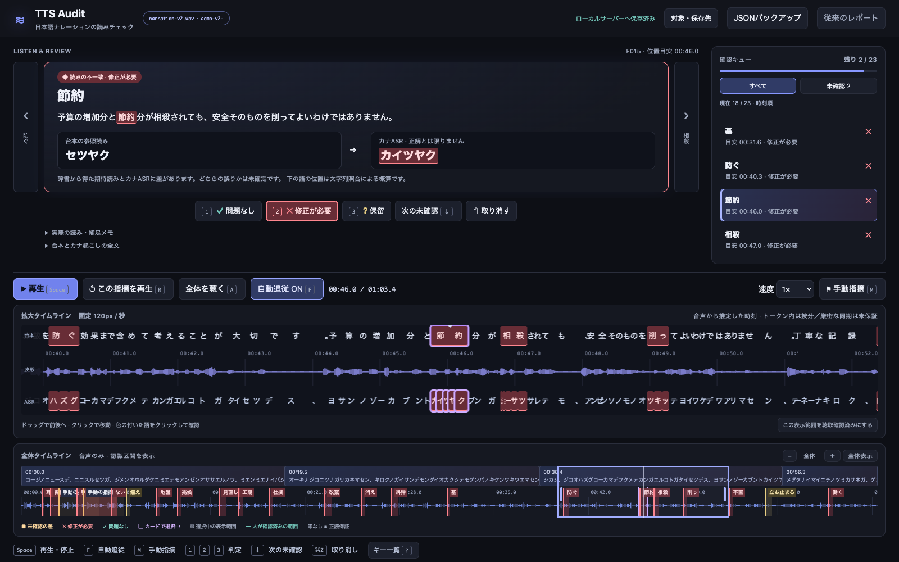
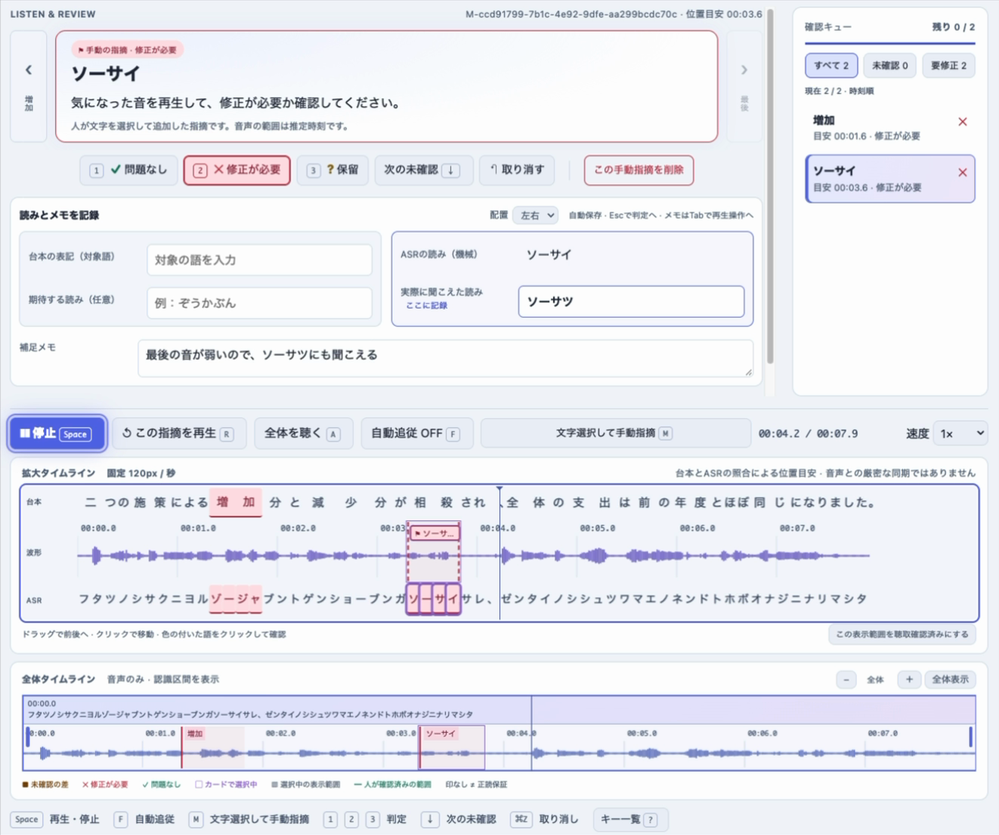
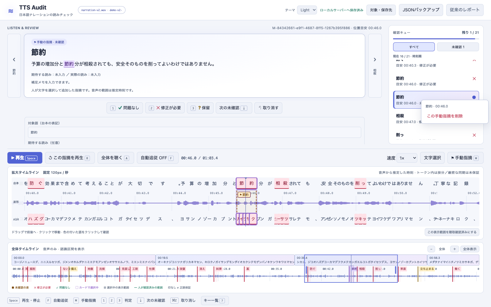

# Japanese TTS Audit Skill · v0.2.0-beta

`japanese-tts-audit-skill` は、日本語ナレーションの**台本＋音声**から、読みの差を音声付きで確認するCLIとAgent Skillです。必要ならAgentが既存のTTSサービスで問題のある文だけを再生成し、CLIで点検・差し替えを管理できます。



実際のv2合成音声を使った確認画面です。台本・カナ・波形を並べ、疑わしい箇所を再生してキーで判定。赤は聴取で「修正が必要」とした箇所です。表示用のファイル名とセッションIDはデモ用に置き換えています。[動画・紹介記事向けの画像素材](docs/promotion-assets.md)

<details>
<summary>試用版について：確認のしくみと動作環境</summary>

このツールは、読み間違いがありそうな箇所を見つけて、耳で確認するためのものです。文字起こしや辞書の読みが違っていても、音声は合っていることがあります。候補に出なかった間違いが残ることもあります。

どのくらいの間違いを拾えて、余計な指摘がどのくらい出るか（検出率・適合率）は、まだ数値で評価していません。実音声での動作はApple Silicon Macで確認しています。

</details>

## 1. npxでSkillを導入する（標準）

[Node.js](https://nodejs.org/en/download)を用意し、制作プロジェクトで次を実行し、使っているAgentを選びます。**Skillの指示を導入する操作です。Python CLIと認識モデルは次の手順で別途準備します。**

```sh
npx skills add chitoku/japanese-tts-audit-skill --skill japanese-tts-audit-skill
```

VercelのSkills CLIを使います。確認した1.7.4版はNode.js 22.20以上が必要です。Codexだけなら末尾に `-a codex`、Claude Codeなら `-a claude-code`。既定は現在のプロジェクトへの導入です。全プロジェクトで使う場合だけ `-g` を追加します。

**公開前の注意：現在はPrivate RepoのためGitHubの取得権限が必要です。** 一般公開後の未認証導入は、公開時に別途確認します。

Agentへの依頼例（音声・台本とCLIの場所は実際のパスを渡します）：

> japanese-tts-audit-skillを使って、この台本と音声を点検してください。音声付きの確認ページを開き、私の判定を読んで、必要な文だけ既存の音声生成サービスで修正・再点検してください。CLI環境がなければ下の手順で準備してください。再生成費用は先に確認してください。

**導入時の通信：** Skills CLIにはskills.shへの導入情報の送信があります。これは点検回数の計測ではありません。送信しない場合は次のように実行できます。この設定はSkills側のセキュリティ監査照会も止めます。`tts-audit`自体は利用状況を遠隔送信しません。

```sh
DISABLE_TELEMETRY=1 npx skills add chitoku/japanese-tts-audit-skill --skill japanese-tts-audit-skill
```

Nodeを使わない場合は、下記のgit取得やZIP展開後、`skills/japanese-tts-audit-skill` をAgentのSkill配置先へコピーできます。Codexの制作プロジェクト内なら `.agents/skills/japanese-tts-audit-skill/` です。既存フォルダを上書きしないでください。Codexの `$skill-installer` にこのRepo内のSkillフォルダURLを渡す方法もあります。[導入指標と実利用の違い・調査結果](docs/adoption-and-measurement.md)

## 2. Python CLIを準備して、無料デモを試す

Python 3.10以上（検証環境3.12）と[uv](https://docs.astral.sh/uv/getting-started/installation/)を用意します。Skillを導入済みでも、実行部品はこの手順が必要です。既存のcloneがある場合は、そのルートでvenv作成以降を実行してください。CLIだけを使う場合はSkill導入を省略できます。

以下はmacOS／Linuxのシェル用です（実音声推論の確認環境はApple Silicon Mac）。Skillの配置先とCLIの保存場所は別で構いません。CLIは制作プロジェクト外のツール用フォルダにcloneしても使えます。

```sh
git clone https://github.com/chitoku/japanese-tts-audit-skill.git
cd japanese-tts-audit-skill
uv venv --python 3.12 .venv
uv pip install --python .venv/bin/python '.[generation]'
.venv/bin/tts-audit --help
```

続けて同じリポジトリ内で、同梱の短い音声を点検します。

```sh
.venv/bin/tts-audit check examples/known-error/audio.mp3 \
  --script examples/known-error/script.txt \
  --readings examples/known-error/readings.json \
  --transcript-json examples/known-error/transcript.json --out outputs/recorded-demo
```

確認画面は次で開きます。起動したサーバーは確認中そのまま動かしておき、終了時はCtrl+Cで止めます。

```sh
.venv/bin/tts-audit serve outputs/recorded-demo --open
```

この例は**保存済みのカナ認識を再利用**するため、モデル・APIキー・課金は不要です。「糾弾」を「シュウタン」と聞いたというユーザー報告のある合成音声です。ほかの差も含みます。音声はMIT対象外です。

## 3. 認識モデルを準備して、自分の音声を点検する

同じリポジトリ内で認識用の依存ライブラリを追加します。モデルは初回の `check` で自動取得するため、最初はインターネット接続が必要です。依存ライブラリ・キャッシュも含め、重み約3.24GBより多い空き容量を確保してください。

```sh
uv pip install --python .venv/bin/python '.[asr,generation]'
.venv/bin/tts-audit check /absolute/path/narration.wav \
  --script /absolute/path/script.txt --out outputs/check
.venv/bin/tts-audit serve outputs/check --open
```

`/absolute/path/...` は実際の音声とUTF-8台本の絶対パスに置き換えます。`--out` は毎回新しいフォルダを指定してください。既存の音声・判定を上書きしない設計です。AgentにはCLIの絶対パス（このRepoの `.venv/bin/tts-audit`）かPythonの絶対パス（`.venv/bin/python`）も伝えると、別の制作フォルダから実行できます。

初回に `sbintuitions/kana-whisper` の重み約3.24GBを取得します。Whisper large-v3-turboの追加学習モデルで、Tinyではありません。MacはMPS、利用可能ならCUDA、それ以外はCPUを選びます。Windows/Linuxの実音声推論は本リリースでは未検証です。

認識時に台本・期待読みのヒントは渡しません。台本はSudachiで別に読みへ変換し、ASRと照合します。点検はローカルで、音声の外部送信・有料ASR API・APIキーは不要です。同じ環境では通常のモデルキャッシュを再利用します。保存先を明示する場合は初回から `--cache-dir /absolute/path/model-cache` を付け、その取得済みキャッシュで通信を避けたい場合だけ、同じ指定に `--offline` を追加します。未取得の環境では `--offline` を付けないでください。

通常のローカル検査は、文字起こしと同時にKana Whisperのトークン時刻を取得し、`audio-timing.json` と `timeline.html` を生成します。台本・カナ・波形を並べて確認でき、Spaceで再生・停止できます。時刻は音声からの推定で、トークン内と文字が一致しない部分は補間します。人が確定した単語境界ではありません。

### 判定をAgentへ直接渡す：ローカル確認サーバー

```sh
.venv/bin/tts-audit serve outputs/check --open
```

表示されたローカルURLで、同じ聴取画面を開きます。判定・聞こえた読み・メモは `outputs/check/review-state.json` に自動保存されます。ダウンロードやチャットへの添付は不要です。従来のレポート画面にある「確認終了」で `status: completed` となり、以後の編集は `draft` に戻ります。タイムラインでの判定保存は `draft` のままです。保存済み表示を確認してください。未判定・保留が残っていても終了でき、それらの件数は明示して残します。終了は正読保証や再生成許可ではありません。

**タイムライン検聴（試作）**も利用できます。`tts-audit serve REPORT_DIRECTORY --open` または返された `timeline_url` を開くと、上ペイン右の確認キュー、二段の波形、ドラッグ移動、台本とカナの併記、キーボード判定・手動フラグを使えます。通常のローカル検査ではKana Whisperのトークン時刻を同時取得し、台本・カナ・候補・自動追従に使います。トークン内や不一致部分は補間するため、厳密な単語境界ではありません。時刻取得を省くには `--no-timestamps`。取得失敗や時刻なしの認識JSON取り込みでは区間内の概算表示へ戻ります。[画面と保存形式の説明](docs/timeline-review.md)

### タイムラインでの確認

ヘッダーの「テーマ」で **Light／Dark／Auto** を切り替えられます。AutoはOSの配色設定に追従し、選択はブラウザーに保存します。波形・判定色もテーマに合わせて再描画し、聴取結果は変えません。[Light表示の例](docs/assets/screenshots/timeline-review-light-readme.png)

- **1：問題なし（緑）／2：修正が必要（赤）／3：保留（黄）**。ボタン、カード、文字、マーカーの色をそろえています。
- **F：自動追従**。音声からの推定時刻がある新規ページではONで開始し、保存済み設定を優先します。
- **↓：次の未確認、↑：前の指摘、Shift＋↓：次の指摘（判定済みも含む）**。
- **M：手動指摘**。対象語が未入力でも両タイムラインに範囲を表示。対象語・期待読み・聞こえた読み・メモを追記でき、削除と取り消しにも対応します。手動項目は確認キューの右クリックメニューからも削除できます。「文字選択」では台本やASRをドラッグし、その文字に直接指摘を付けられます。
- **R：今の指摘を聴き直す、⌘Z／Ctrl＋Z：取り消し、?：キー一覧**。入力欄では文字入力を優先します。

「文字選択」をON → 台本またはASRをドラッグ → 「選んだ文字に指摘を追加」の順で使います。選択欄は先に高さを確保し、ドラッグ中にタイムラインが動かないようにしています。ASRの選択文字は「聞こえた読み」にも入ります。右クリック削除は手動指摘だけに対応し、削除後は取り消せます。

<details>
<summary>文字選択と右クリック削除の画面を見る</summary>





</details>

ヘッダーの「対象・保存先」に元の音声・台本パス、保存先、実行ごとのセッションID、保存リビジョンを表示します。元パスのない旧レポートでは「未記録」と明示します。サーバー保存が完了すれば、**JSONバックアップのダウンロード・添付は通常不要**です。手動指摘の削除は履歴を残して非表示にし、元のASRや音声は変更しません。

AgentはHTMLを解析せず、このJSONのrun_id・report_sha256・status・notesを読みます。サーバーは127.0.0.1だけで待ち受け、空きポートと推測困難なセッションURLを使います。Ctrl+Cで停止しても保存内容は残り、同じコマンドで再開できます。別の画面からの古い更新は拒否し、入力は画面に保持します。通常利用の手順とJSONの意味は [ローカル確認の仕様](skills/japanese-tts-audit-skill/references/review-server.md) を参照してください。

HTMLをファイルとして直接開く従来の方式も使えます。その場合、メモはブラウザー内に保存され、HTMLファイルには書き戻しません。JSONを書き出してバックアップします。取り込みは次のとおりです。

```sh
.venv/bin/python -m tts_audit.reviews outputs/check exported-notes.json
```

境界付近の差は、切り位置を変えて自動で一度再確認します。文脈まで一致した差だけ優先度を下げ、元の結果を残します。`--no-boundary-recheck` で無効化できます。保存済み認識の持ち込み時は既定で再認識しません。

## 使っている音声生成サービスとの関係

点検は音声ファイルを入力するため、生成元のサービスを問いません。Skillで修正を進める際は、制作者が使っているサービス・モデル・声・設定を引き継ぎます。Agentから操作できるAPIやツールがあればその方法で該当文を再生成し、なければ制作者にその文の再生成を依頼して、返された音声を再点検します。自動的にElevenLabsへ切り替えません。

文単位のプロジェクト管理は生成元に依存しません。**生成・再生成はエージェントが既存サービスで行い、CLIは音声の取り込み・点検・承認・採用版の差し替えを担当します。** 各サービスのAPIや編集ツールへの接続は、その環境で使える手段をエージェントが選びます。全サービスへの接続をCLIが内蔵しているわけではありません。

## 一文ずつ点検・修正する（任意のTTSサービス）

```sh
.venv/bin/tts-audit sentences init --script script.txt --readings readings.json \
  --out outputs/project --provider external --source-json source.json
```

初期化はAPIを呼ばず、音声を生成しません。`--provider external` は既定なので省略できます。`source.json` は元の制作環境の情報です。実際に使用中のサービス・モデル・声・設定を記録し、APIキーは含めません。不明な場合は `--source-json` を省略して初期化できます。

```json
{"provider":"使用中のサービス名","model":"使用中のモデル名","voice":"使用中の声","settings":{}}
```

エージェントが既存サービスで文ごとの音声を生成するか、既存の文単位音声を書き出し、取り込みます。

```sh
.venv/bin/tts-audit sentences import-audio outputs/project --sentence S001 \
  --audio sentence-S001.wav --source-json source.json --note '元の制作環境から取り込み'
.venv/bin/tts-audit sentences check outputs/project --sentence S001 --version latest --cache-dir CACHE --offline
```

`outputs/project/index.html` で文と各版の音声・点検レポートを確認できます。`review` で承認・要修正と根拠を記録します。修正が必要なら、エージェントが**同じサービス・声・設定で該当文だけ**再生成します。かなに開くなど生成専用の変更は別ファイルに残し、元の台本は維持します。

```sh
# 既存サービスで作った修正版を候補として取り込み
.venv/bin/tts-audit sentences import-audio outputs/project --sentence S001 \
  --audio corrected-S001.wav --text-file corrected-S001.txt \
  --source-json source.json --note '既存サービスで該当文のみ再生成'
.venv/bin/tts-audit sentences check outputs/project --sentence S001 --version latest --cache-dir CACHE --offline
.venv/bin/tts-audit sentences review outputs/project --sentence S001 --version latest \
  --verdict approved --basis asr --note '再点検の結果を記録。人の聴取済みとは区別'
.venv/bin/tts-audit sentences select outputs/project --sentence S001 --version v002
```

`v002` は候補の実際の版番号に合わせます。取り込んだだけでは既存の採用版を変更しません。点検・承認後に該当文だけを選び直し、他の確認済み音声を保持します。`--text-file` がない取り込みでは、生成用入力は元台本と同じという仮定を明示します。実際に修正した入力は必ず添えてください。外部サービスの費用はCLIの内蔵予算に自動集計しないため、エージェントがユーザーの予算と既使用分を確認します。

結合は `sentences assemble outputs/project --out outputs/mix`。通常は全採用文の承認が必要です。文ごとの16kHz PCMサンプルを保持して結合し、継ぎ目の試聴音声も出します。話し方・声量・間の自然さは別途確認します。元が連続音声だけの場合、無劣化で該当文を差し替えられるとは限らず、元の編集環境か文単位の書き出しが必要です。詳細は [文単位ワークフロー](skills/japanese-tts-audit-skill/references/sentences.md)。

実音声で行った [VOICEVOXの一文修正の実演](examples/voicevox-sentence-repair/README.md) では、「脇本陣→ワキモトジン」を生成用入力で直し、同じVOICEVOXでその文だけ1回再生成しました。再点検後にその文だけ差し替え、他の2文の音声・判定・関連ファイルが不変であることを検証しています。修正版の採用根拠はASRで、人の再聴取とは区別しています。

### 任意：ElevenLabsの内蔵生成アダプター

既存の制作環境がElevenLabsなら、補助機能としてCLIから直接生成する方法も残しています。これを既定の生成先にはしません。

```sh
.venv/bin/tts-audit sentences init --script script.txt --out outputs/eleven-project \
  --provider elevenlabs --model eleven_v3 --voice-id VOICE_ID \
  --budget-usd 15 --baseline-usd PRIOR_RESERVE --max-new-usd NEW_LIMIT
.venv/bin/tts-audit sentences generate outputs/eleven-project --key-file PRIVATE_KEY_FILE --max-requests SENTENCE_COUNT
```

この任意アダプターはテキスト送信とクレジット消費を伴います。秘密キーはプロジェクトに保存しません。予算は安全側の予約額で請求額とは異なり、他プロジェクト・共有アカウントの利用は自動集計しません。既存のElevenLabsプロジェクトと旧形式の呼び出しは引き続き利用できます。

## Codex Skillとして使う

このRepoには、公式のリポジトリ配置である `.agents/skills/japanese-tts-audit-skill` から `skills/japanese-tts-audit-skill` への参照があります。このリポジトリでCodexを開き、CLIを導入したPython環境を使ってください。

依頼例：

> $japanese-tts-audit-skill この台本と音声を点検して、音声付きの要確認レポートを作ってください。Pythonは .venv/bin/python を使ってください。

別の作業場所で使う場合は、Skillフォルダをインストールし、CLIも別途導入します。Skillだけでは認識依存やモデルは入りません。ローカル配置の現在の規約は [OpenAI公式ガイド](https://learn.chatgpt.com/docs/build-skills) を参照してください。Pluginディレクトリへの登録は本リリースの範囲外です。

## 検証と限界

```sh
.venv/bin/python -m unittest discover -s tests -v
```

テストは、読み照合、ASR境界の再確認、聴取記録、予算、再試行防止、版管理、確認済み音声の保持、PCM結合を検証します。生成APIはモックで、実行しても音声生成費用はかかりません。GitHub Actionsの [自動テスト](.github/workflows/tests.yml) はpush・pull request・手動実行で動きます。Ubuntu / Python 3.12でユニットテストと保存済み認識によるスモークテストを実行します。有料APIやASRモデルは使いません。[初回実行は成功しました](https://github.com/chitoku/japanese-tts-audit-skill/actions/runs/39626915152)。テンプレートは docs/github-actions-tests.yml にも残しています。

実際の誤警報には「経典」をヒョーテンと認識した例、読経の許容読みドッキョウ、ツヅケ／ツズケの表記差、短文での認識の揺れがあります。辞書、ASR、TTS、許容読み、曖昧な音を区別してください。本ツールはJoyo公式の採点実装でも、TTSモデルのリーダーボードでもありません。

クリーン環境で確認した範囲と未確認事項は [検証記録](docs/verification.md)。実利用の報告は任意で、インストール数を実行数や効果とみなしません。本CLIに遠隔テレメトリーはありません。第三者のSkills CLIの導入情報送信は別です。[利用状況の把握方針](docs/adoption-and-measurement.md)を参照してください。

## ライセンスと協力

コード・Skill・文書はMITです。合成音声、声モデル、認識モデル、辞書、依存ライブラリはそれぞれ別の扱いです。[第三者部品と音声の注意](THIRD_PARTY_NOTICES.md)／[実例の出典](examples/README.md)。

不具合・聴取結果を共有する方法は [CONTRIBUTING.md](CONTRIBUTING.md)。キー・私的な台本や音声を含めず、共有できる範囲の実行条件と確認範囲を添えてください。

## 開発チェックポイント

2026-10-21時点の到達点、Google／VOICEVOX比較の聴取範囲、参照読みの見逃し、次の製品改善は [プロジェクトの現在地](docs/project-status-2026-10-21.md) にまとめています。[研究記録](research/2026-10-21/README.md) の実験用コードと、インストールされるCLIの機能範囲は異なります。
## 誤読実例の正本・ベンチマーク

今後の収集先は [data/benchmark](data/benchmark/README.md) です。[語と誤読の一覧](data/benchmark/WORDLIST.md) から、期待読み・聴取読み・出典・固定音声にたどれます。初版v0.1.0は1,150表記・2,241例文の台帳と、聴取済み誤読32箇所／誤警報対照9箇所の開発評価セットを含みます。収集報告・要裁定・別読みは採点から分離しています。既存の研究記録はこの台帳の出典として残します。
